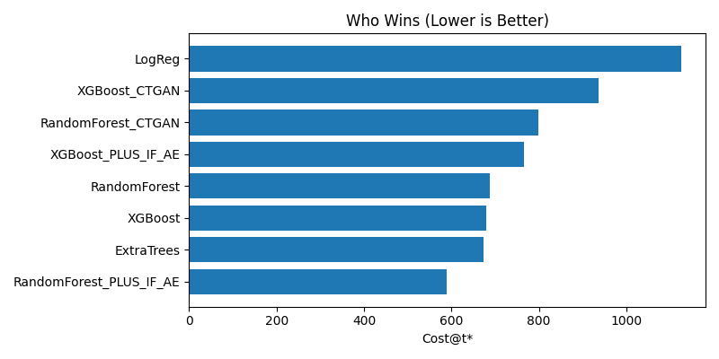
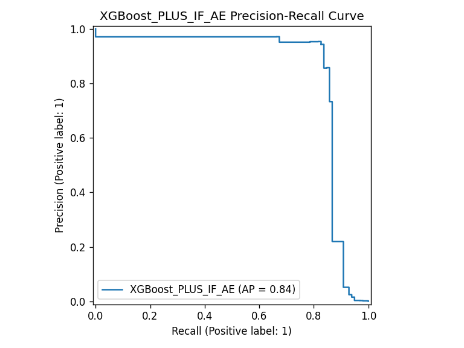
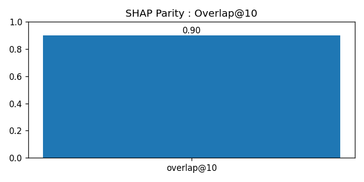

# AI/ML Fraud Anomaly Detection | Cost-Aware & Explainable AI

**Doctoral Research | Doctor of Engineering (D.Eng.) in Cybersecurity Analytics | The George Washington University**

## Research Overview

My doctoral research focused on a practical challenge in financial fraud detection: identifying fraudulent transactions while managing false alerts, missed fraud, and the need for explainable decisions.

I examined how machine learning models could be evaluated beyond traditional accuracy measures, particularly when fraudulent transactions represent only a small fraction of the available data.

The research combined supervised machine learning, synthetic data augmentation, anomaly detection, and explainable AI. I evaluated these approaches individually and in combination, with particular attention to operational cost, model reliability, and transparency.

## Research Objective

The primary objective was to determine whether cost-aware machine learning methods could improve fraud detection decisions without sacrificing meaningful detection performance.

The research addressed three practical questions:

- Can cost-sensitive decision thresholds reduce the impact of false positives and missed fraudulent transactions?
- Does synthetic data augmentation improve model performance when fraud examples are limited?
- Can anomaly detection and explainability techniques improve model evaluation and support more transparent decisions?

## Methodology

The study used a publicly available credit-card fraud dataset containing 284,807 transactions. Fraudulent transactions accounted for approximately 0.17% of the data, making this a highly imbalanced classification problem.

The research included:

- **Dataset:** Public credit-card fraud benchmark with 284,807 transactions
- **Data preparation:** Stratified 60% training, 20% validation, and 20% testing split
- **Machine learning models:** Logistic Regression, Random Forest, Extra Trees, and XGBoost
- **Synthetic data augmentation:** CTGAN, with augmentation restricted to training data
- **Anomaly detection:** Isolation Forest and Autoencoder-based features
- **Explainability:** SHAP comparisons using real and synthetic validation data
- **Model evaluation:** Precision, recall, F1-score, PR-AUC, and cost-sensitive threshold optimization

To evaluate operational trade-offs, the study assigned a cost weight of 1 to false positives and 50 to false negatives. These were abstract cost units used for comparative evaluation, not actual financial losses.

The experimental design separated training, validation, and testing to reduce data leakage and support reliable comparisons.

## Selected Research Findings

The Random Forest model incorporating Isolation Forest and
Autoencoder anomaly features achieved the lowest weighted
classification cost among the evaluated configurations.

The operating threshold (t*) was selected using validation
data to minimize the weighted cost of false positives and
false negatives.

| Research Finding | Result |
|---|---|
| Best-performing configuration | Random Forest + Isolation Forest + Autoencoder |
| Weighted cost at t* | 590 cost units |
| Precision at t* | 68.5% |
| Recall at t* | 88.8% |
| PR-AUC (winning RF model) | 0.847 |
| SHAP top-10 feature overlap | 90% |
| SHAP Spearman rank correlation | 0.9633 |

**Cost policy:** False positives were assigned a weight of 1,
while false negatives were assigned a weight of 50.
The resulting cost values represent comparative penalties,
not actual financial losses.

### Model Cost Comparison

**Model cost comparison.** The Random Forest model with
Isolation Forest and Autoencoder features achieved the
lowest weighted classification cost of 590 under the
study's 1:50 cost policy.

### Cost-Aware Fraud Detection

Cost-sensitive threshold optimization helped identify operating points that reduced the weighted impact of classification errors.

Rather than relying on a default decision threshold, the research evaluated the trade-off between missed fraudulent transactions and false alerts.

### Anomaly-Feature Fusion

Combining supervised machine learning with anomaly signals from Isolation Forest and an Autoencoder improved cost efficiency in the tested configurations.

The Random Forest configuration incorporating both anomaly features achieved the lowest observed cost in the reported experiments.

### Precision–Recall Performance

**Figure 12.** Precision–Recall curve for XGBoost with
Isolation Forest and Autoencoder features, showing an
average precision of approximately 0.84.

The Random Forest anomaly-fusion configuration achieved
the lowest weighted cost, while this figure illustrates
the precision-recall performance of the XGBoost hybrid.

### Synthetic Data Augmentation

One important finding was that CTGAN-generated synthetic data did not improve model performance for the dataset and experimental split evaluated.

This result highlighted the importance of validating synthetic data before incorporating it into model training. Generating additional samples does not automatically produce better fraud detection results.

### Explainable AI

SHAP was used to examine feature contributions and compare explanations generated from real and synthetic validation data.

The analysis showed strong agreement in feature-importance rankings, including a 90% overlap among the top ten features and a Spearman rank correlation of approximately 0.96.

These findings support explainability comparisons as one component of evaluating synthetic data. However, explanation similarity alone does not establish model reliability or privacy protection.

### SHAP Explainability Comparison

**SHAP parity.** The real and synthetic validation
datasets showed 90% overlap among their top ten
SHAP-ranked features, with a Spearman rank correlation
of 0.9633.

## Research Implementation

The experiments were developed in Python using Google Colab, with AI-assisted coding support during implementation.

My research work involved evaluating model behavior, comparing experimental results, interpreting findings, and documenting the methodology and conclusions in the completed doctoral praxis.

Selected Jupyter notebooks and research visualizations are being organized for public access through this repository.

The doctoral research has been successfully defended, approved, and published.

## Limitations and Future Research

The research was conducted using a public benchmark dataset under defined experimental conditions. Although the results demonstrate the potential value of cost-aware modeling and anomaly-feature fusion, they should not be interpreted as evidence of performance across all financial environments.

The project did not include production deployment, operational drift monitoring, or federated learning implementation.

Future research could explore additional fraud datasets, changing transaction patterns, privacy-preserving collaboration, and the integration of explainability and monitoring into operational fraud detection systems.

## Publication and Citation

**Research Title:** AI/ML-Driven Methods for Fraud Anomaly Detection

**Researcher:** Eva Okhankhuele, D.Eng.

**Degree:** Doctor of Engineering in Cybersecurity Analytics

**Institution:** The George Washington University

**Research Status:** Completed, successfully defended, approved, and published.

**Official Publication:** A link to the published doctoral praxis will be added when its official repository or ProQuest URL is available.

The full doctoral praxis is not reproduced in this GitHub repository. This repository presents selected research methods, findings, and supporting technical artifacts.

## Copyright and Usage

Copyright © 2025 Eva Okhankhuele. All rights reserved.

Original research materials are protected by copyright, subject to applicable university publication agreements and third-party rights.

The public dataset and third-party software libraries remain subject to their respective licenses and terms.

---

[Back to Cybersecurity, AI/ML & Data Analytics Portfolio](https://github.com/evaebaide/cybersecurity-ai-ml-data-analytics-portfolio)

